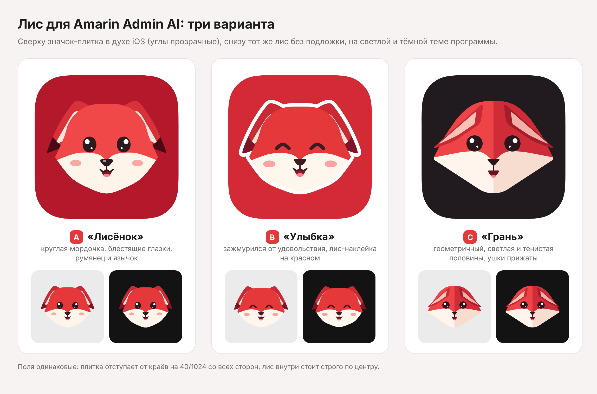

# Значок: лис

Варианты нового значка Amarin Admin AI. Красный, плоский, 2D: милый лис с опущенными ушками
и приоткрытым ротиком. Из них выбирается один.

|   | Вариант | Плитка |
|---|---|---|
| A | «Лисёнок»: круглая мордочка, блестящие глазки, румянец и язычок | малиновая |
| B | «Улыбка»: зажмурился от удовольствия, белая обводка, как у наклейки | красная |
| C | «Грань»: геометричный, светлая и тенистая половины, ушки прижаты | тёмная |

У каждого варианта два вида; в именах файлов `x` означает букву варианта (a, b или c):

- `fox-x-tile.svg`, `fox-x-tile.ico`: плитка в духе iOS, квадрат с плавно скруглёнными углами и
  прозрачными уголками. Для exe, панели задач и Проводника.
- `fox-x-mark.svg`, `fox-x-mark.ico`: тот же лис без подложки. Для самой программы: логотип в
  боковой колонке, значок в трее.
- `fox-x-tile-alt.svg`: плитка другого цвета.

Подробный лист с мелкими размерами, видом в программе и сеткой отступов: [preview.png](preview.png).

## Отступы

Поле 1024×1024. Плитка отступает от краёв на 40 со всех четырёх сторон (на 256 px это 10 px),
лис стоит внутри неё ровно по центру: поля слева и справа равны, сверху и снизу тоже. Знак без
подложки отступает от краёв на те же 40 по бокам и стоит точно посередине по высоте. У нынешней
«A» поля разные: слева 20 px, справа 31 (на 256).

## ICO

Кадры 256, 128, 96, 64, 48, 40, 32, 24, 20 и 16 px. Каждый нарисован из вектора под свой размер,
а не ужат из большого: от 40 px полный рисунок, на 24-32 px без румянца и тонких линий рта, на
16-20 px остаются силуэт, маска, глаза и нос. Кадры от 64 px хранятся как PNG, мелкие как
32-битные BMP; порядок от крупного к мелкому.

## Как пересобрать

Рисунок задан кодом в `src/fox_icons.py` (точки контуров, цвета, уровни детализации), всё
остальное собирается из него:

    pip install skia-pathops pillow
    npm install -g playwright && npx playwright install chromium
    python3 design/app-icon/src/make.py

Скрипт перезаписывает SVG, ICO и оба листа в этой папке. SVG на выходе состоят только из залитых
путей, без масок и обводок, поэтому контуры переносятся в XAML как есть.
